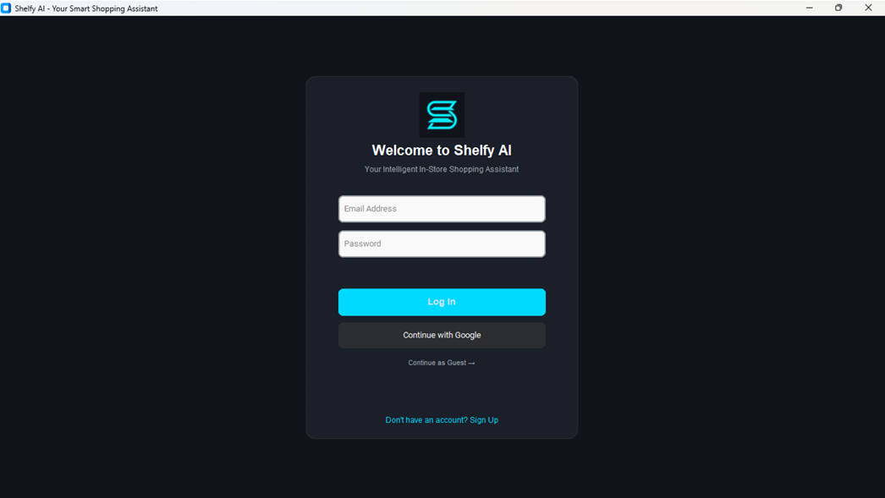
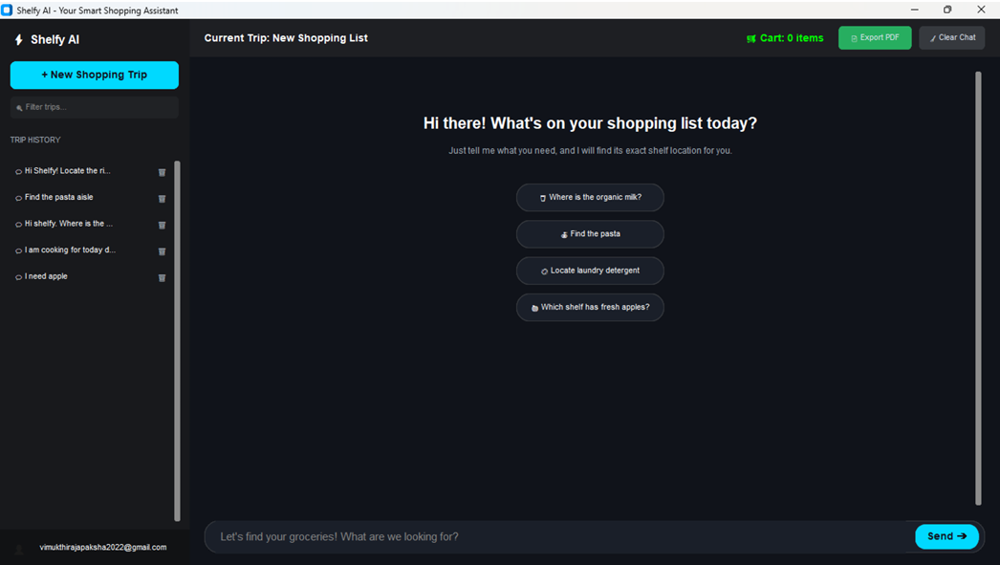
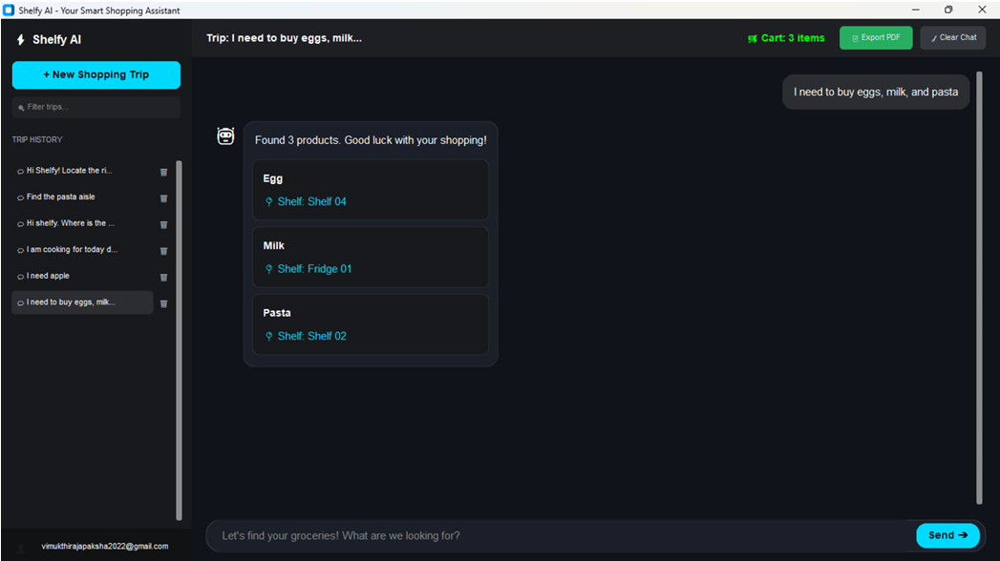
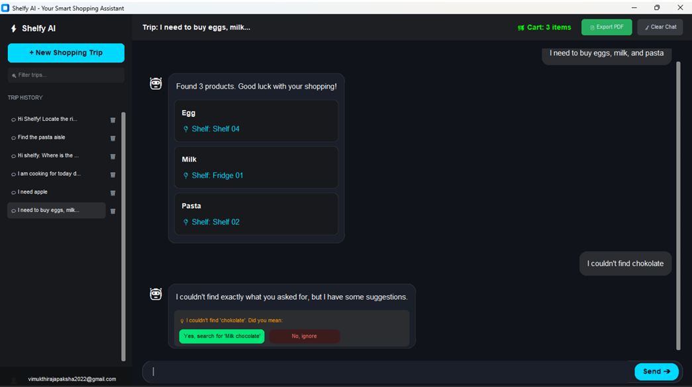
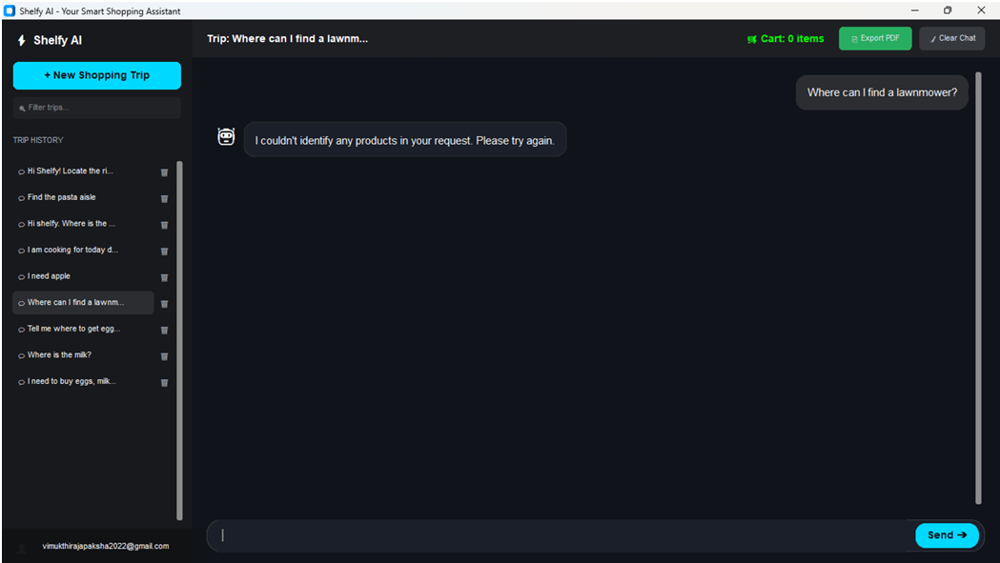
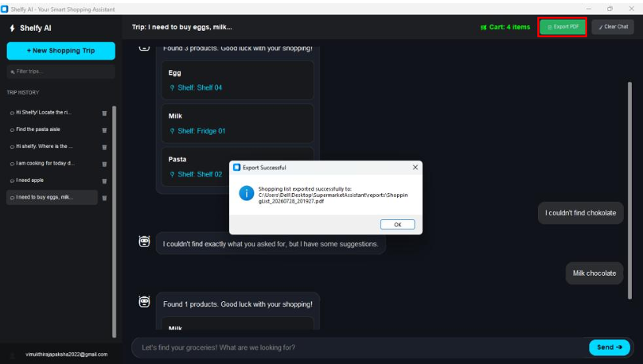
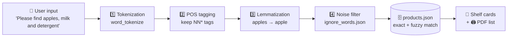

<div align="center">


# Shelfy AI

### Your intelligent in-store shopping assistant

Type your grocery list in plain English. Shelfy finds every item, tells you exactly which shelf it's on, and prints a pocket-sized shopping list.


[Features](#-features) • [Demo](#-demo) • [Quick Start](#-quick-start) • [How the NLP Works](#-how-the-nlp-works) • [Project Structure](#-project-structure) • [Roadmap](#-roadmap)

</div>

---

## About

**Shelfy AI** is a desktop chatbot designed to sit on a kiosk at a supermarket entrance. A shopper types what they want to buy, for example *"Hello! Today I need to buy items for my house. Please find apples, milk, and detergent."*, and Shelfy:

1. Uses **Natural Language Processing** to pull out only the real grocery items,
2. Looks each one up in a **product-location database** (101 products across 18 shelf zones),
3. Shows a **product card** with the shelf location for every item, and
4. Exports a clean **PDF shopping list** the shopper can take along.

> Built for **CO3251 – Natural Language Processing (Assignment 2)**.

---

## Features

| | Feature | Details |
|---|---|---|
| 🧠 | **NLP item extraction** | Tokenization → POS tagging → lemmatization → noise filtering with NLTK |
| 🔎 | **Smart product lookup** | Exact match first, then fuzzy matching for typos (`difflib`) |
| ✏️ | **Typo recovery** | *"I couldn't find 'chokolate'. Did you mean **milk chocolate**?"* with one-tap Yes / No buttons |
| 🛒 | **Live cart** | Every found item is added to a running cart with a live counter |
| 🖨️ | **PDF export** | One-click printable list with item names, shelf locations, date and time (ReportLab) |
| ☁️ | **Cloud sync** | Shopping trips are saved to Firebase Realtime Database and listed in a searchable sidebar |
| 🔐 | **Authentication** | Email/password, Google Sign-In (OAuth2), or guest mode |
| 🌙 | **Modern dark UI** | Responsive CustomTkinter interface with a typing animation and quick-start prompts |

---

## Demo

📹 **Video demonstration:** [Watch on Google Drive](https://drive.google.com/drive/folders/1gX56rXOlzwE3b60ZS6uFF-Ebx3De7a05?usp=sharing)

📘 **Full user guide:** [`User Guide`](docs/user_guide.pdf)

<table>
  <tr>
    <td align="center"><b>Login</b><br></td>
    <td align="center"><b>Welcome screen</b><br></td>
  </tr>
  <tr>
    <td align="center"><b>Multi-item list → shelf cards</b><br></td>
    <td align="center"><b>Typo suggestion</b><br></td>
  </tr>
  <tr>
    <td align="center"><b>Unknown item handling</b><br></td>
    <td align="center"><b>PDF export</b><br></td>
  </tr>
</table>

### Sample conversations

| Shopper says | Shelfy responds |
|---|---|
| `Where is the milk?` | 1 card: **Milk → Fridge 01** |
| `I need to buy eggs, milk, and pasta` | 3 cards: **Egg → Shelf 04**, **Milk → Fridge 01**, **Pasta → Shelf 02** |
| `Tell me where to get eggs, broccoli, and brown rice` | 3 cards: **Egg → Shelf 04**, **Broccoli → Produce C**, **Rice → Shelf 02** |
| `I couldn't find chokolate` | Suggestion bubble: *Did you mean "milk chocolate"?* `Yes` / `No, ignore` |
| `Where can I find a lawnmower?` | *"I couldn't identify any products in your request. Please try again."* (nothing is added to the list) |

---

## 🧠 How the NLP works

Shelfy turns a free-form sentence into clean database lookups in four steps (`src/nlp_processor.py`):



| Step | Technique | Purpose |
|---|---|---|
| 1 | **Tokenization** (`nltk.word_tokenize`) | Split the sentence into individual words |
| 2 | **POS tagging** (`nltk.pos_tag`) | Keep only nouns (`NN`, `NNS`, `NNP`…); verbs and adjectives are dropped |
| 3 | **Lemmatization** (`WordNetLemmatizer`) | Convert plurals to singular so `apples` matches `apple` |
| 4 | **Noise filtering** | Remove conversational nouns (`items`, `today`, `house`…) using a 500+ word, editable `ignore_words.json` |

**Example**

```text
Input : "Hello! Today I need to buy items for my house. Please find apples, milk, and detergent."
Output: ['apple', 'milk', 'detergent']
```

After extraction, `ProductDatabase.search_product()` tries an **exact match** first, then falls back to **fuzzy matching** (`difflib.get_close_matches`, cutoff 0.6) to offer "Did you mean…?" suggestions.

---

## 🚀 Quick start

### Prerequisites

- **Python 3.9 or newer** (developed on 3.11)
- `pip` and Git
- A **Firebase project** (Authentication + Realtime Database), see [Configuration](#-configuration)
- *(Optional)* a Google Cloud OAuth client for "Continue with Google"

### 1. Clone the repository

```bash
git clone https://github.com/<your-username>/shelfy-ai.git
cd shelfy-ai
```

### 2. Create a virtual environment

```bash
# Windows (PowerShell)
python -m venv .venv
.venv\Scripts\Activate.ps1

# macOS / Linux
python3 -m venv .venv
source .venv/bin/activate
```

### 3. Install dependencies

```bash
pip install -r requirements.txt
```

### 4. Download the NLTK data

The app tries to download these automatically on first run; you can also do it up front:

```bash
python -c "import nltk; [nltk.download(p) for p in ['punkt','punkt_tab','averaged_perceptron_tagger','averaged_perceptron_tagger_eng','wordnet','omw-1.4']]"
```

### 5. Configure your credentials

See [Configuration](#-configuration) below.

### 6. Run Shelfy

```bash
python -m src.main
```

> Run this from the **project root** (the folder containing `src/`) so `client_secrets.json`, `firebase_config.json` and `database/` are found. Exported PDFs are saved to `generated_reports/`.

---

## 🔧 Configuration

Credentials are **not stored in this repository**. Create these two files in the project root (both are git-ignored):

**`firebase_config.json`**: copy `firebase_config.example.json` and fill in the values from *Firebase Console → Project settings → Your apps → Web app*.

**`client_secrets.json`**: *(only needed for Google Sign-In)* copy `client_secrets.example.json` and fill it in from *Google Cloud Console → APIs & Services → Credentials → OAuth client ID (Desktop app)*.

```bash
# Windows
copy firebase_config.example.json firebase_config.json
copy client_secrets.example.json client_secrets.json

# macOS / Linux
cp firebase_config.example.json firebase_config.json
cp client_secrets.example.json client_secrets.json
```

**Firebase setup checklist**

1. Create a project at [console.firebase.google.com](https://console.firebase.google.com).
2. Enable **Authentication → Sign-in method → Email/Password** (and **Google** if you want Google Sign-In).
3. Create a **Realtime Database** and copy its URL into `databaseURL`.
4. Set database rules so each signed-in user can only read and write their own data.

---

## 🗂️ Project structure

```text
shelfy-ai/
├── src/
│   ├── __init__.py
│   ├── main.py               # Entry point: initialises assets and launches the GUI
│   ├── gui.py                # CustomTkinter interface (login, chat, sidebar, cart)
│   ├── chatbot.py            # Controller linking NLP + database → structured response
│   ├── nlp_processor.py      # Tokenization, POS tagging, lemmatization, noise filter
│   ├── database.py           # Product lookup: exact + fuzzy matching
│   ├── firebase_manager.py   # Auth (email / Google) and cloud chat-history sync
│   ├── printer.py            # PDF shopping-list generation (ReportLab)
│   ├── animation.py          # "Shelfy is thinking…" typing animation
│   ├── utils.py              # Folder and placeholder-asset bootstrap
│   └── constants.py          # Paths, theme colours, fonts, app settings
├── database/
│   ├── products.json         # 101 products → shelf locations
│   └── ignore_words.json     # Conversational nouns to filter out
├── assets/                   # Logo, icons and demo video
├── generated_reports/        # Exported PDF shopping lists (git-ignored)
├── docs/
│   ├── user_guide.pdf        # Full user guide
│   └── screenshots/          # Images used in this README
├── requirements.txt
├── client_secrets.example.json
├── firebase_config.example.json
├── .gitignore
└── README.md
```

### Adding or editing products

Open `database/products.json` and add an entry; no code changes needed:

```json
{ "name": "cereal", "shelf": "Shelf 04" }
```

Use lowercase, singular names, because the lemmatizer converts the shopper's words to singular before searching. To stop a word being treated as a product, add it to `database/ignore_words.json`.

---

## 🗺️ Shelf zones

| Zone | Examples |
|---|---|
| **Produce A–D** | Fruit, root vegetables, leafy greens, peppers, mushrooms |
| **Fridge 01–03** | Milk and plant milks, butter and cheese, yogurt, tofu, hummus |
| **Bakery 01** | Bread, baguette, bagels, croissants, muffins |
| **Meat Section / Seafood Section** | Chicken breast, ground beef, bacon / salmon, shrimp |
| **Shelf 02–07** | Rice, pasta, oats / tea and coffee / eggs, honey / chocolate / sugar, flour / cooking oils |
| **Aisle 01–02** | Soap, shampoo, toothpaste, detergent |

*(101 products across 18 locations, see `database/products.json` for the full list.)*

---

## 🛠️ Tech stack

| Area | Technology |
|---|---|
| Language | Python 3.9+ |
| NLP | NLTK (`punkt`, POS tagger, WordNet) |
| Fuzzy matching | `difflib` (standard library) |
| GUI | CustomTkinter, Pillow |
| Auth and cloud | Firebase Auth and Realtime Database via `pyrebase4`, Google OAuth2 (`google-auth-oauthlib`) |
| PDF | ReportLab |

---

## ❓ Troubleshooting

| Problem | Fix |
|---|---|
| `LookupError: Resource punkt_tab / averaged_perceptron_tagger_eng not found` | Newer NLTK versions use renamed resources. Run the download command in [step 4](#4-download-the-nltk-data). |
| `ModuleNotFoundError: No module named 'src'` | Run from the project root using `python -m src.main`. |
| `Configuration Error: 'client_secrets.json' missing` | Add the file (see [Configuration](#-configuration)) or use email login / guest mode. |
| Google login window doesn't open | Check that the OAuth client type is **Desktop app** and `http://localhost` is an allowed redirect URI. |

---

## 🔮 Roadmap

- [ ] Let customers optionally enter an email to receive their list digitally
- [ ] Direct receipt-printer integration (currently exports a PDF)
- [ ] Quantity parsing (*"2 litres of milk"*)
- [ ] Multi-word product recognition (*"brown rice"*, *"olive oil"*) via noun-phrase chunking
- [ ] Interactive store map highlighting the route between shelves
- [ ] Unit tests for the NLP pipeline

---

## 👤 Author

**R.A.V.U. Rajapaksha**

---

